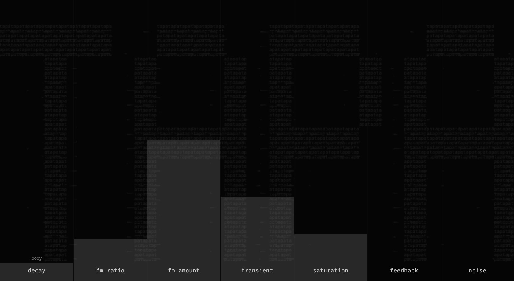

# Tapa

A monophonic drum synth with FM, noise, and metallic resonances. Seven controls
and 20 presets. Available as CLAP, VST3, AU (macOS), a standalone app, WCLAP,
and an iOS app with an AUv3.



| Control | Effect |
| --- | --- |
| Decay | Tail length: 20–4000 ms at MIDI note 60. |
| FM Ratio | Modulator tuning, metallic pitch, and noise colour. |
| FM Amount | FM depth and metallic spread. |
| Transient | Attack shape; clustered claps at mid settings with Noise near 100%. |
| Saturation | Harmonics and density. |
| Feedback | FM roughness and metallic ringing. |
| Noise | FM body → metal and wash → pure filtered noise. |

Higher notes decay faster; lower notes ring longer. Cymbals track more gently.
**Body / linked** switches from short FM decay to following the main Decay.
Pitch and velocity follow MIDI; note-off lets the tail finish. Changes apply on
the next hit. Preset descriptions include suggested MIDI notes.

Drag vertically or across sliders. Double-click to reset. Drag the corner to
resize the window.

## Build

Requires CMake 3.28+ and a C++20 compiler (on Linux also `libasound2-dev`,
`libgtk-3-dev` and `libwebkit2gtk-4.1-dev`). CMake downloads the
[char-clap-template](https://github.com/charCulbert/char-clap-template)
libraries Tapa is built on, at the release in `CMakeLists.txt`. chardsp is a
submodule in `libs/chardsp`.

```sh
git clone --recurse-submodules https://github.com/charCulbert/Tapa.git
cd Tapa
cmake -B build && cmake --build build --config Release
ctest --test-dir build -C Release
```

That builds CLAP, VST3, AU (macOS) and a standalone app, in `build/` (on
Windows, in `build/CLAP/Release/` and `build/Release/`).

For WCLAP, install [WASI SDK 33](https://github.com/WebAssembly/wasi-sdk/releases):

```sh
cmake -B build-wclap -DCMAKE_TOOLCHAIN_FILE=<wasi-sdk>/share/cmake/wasi-sdk-p1.cmake
cmake --build build-wclap        # makes build-wclap/Tapa.wclap.tar.gz
```

For the iOS app with its AUv3 (signing for a device needs your team in Xcode):

```sh
cmake -B build-ios -G Xcode -DCMAKE_SYSTEM_NAME=iOS
```

To build against a local checkout of the template, add
`-DFETCHCONTENT_SOURCE_DIR_CLAP_TEMPLATE=<checkout>` when you configure.

## Credits

Built with these projects. Credit goes to their maintainers and contributors:

- [CLAP](https://github.com/free-audio/clap) and [clap-wrapper](https://github.com/free-audio/clap-wrapper), with the SDKs clap-wrapper downloads.
- [CHOC](https://github.com/Tracktion/choc).
- [char-clap-template](https://github.com/charCulbert/char-clap-template) and [Compost](https://github.com/charCulbert/compost).
- [chardsp](https://github.com/charCulbert/chardsp), with [Signalsmith DSP](https://github.com/Signalsmith-Audio/dsp).
- [WASI SDK](https://github.com/WebAssembly/wasi-sdk), [LLVM](https://github.com/llvm/llvm-project), and [wasi-libc](https://github.com/WebAssembly/wasi-libc), including the wider upstream projects they incorporate.

## License

MIT. See [LICENSE](LICENSE). Every build ships this license and the
[third-party notices](THIRD_PARTY_NOTICES.md), with the full dependency license
texts in `THIRD_PARTY_LICENSES/`.
